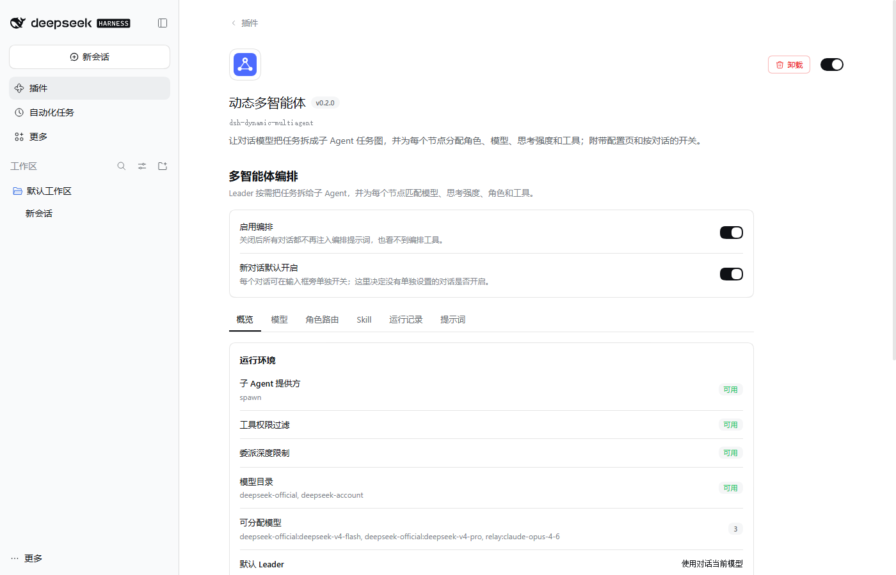
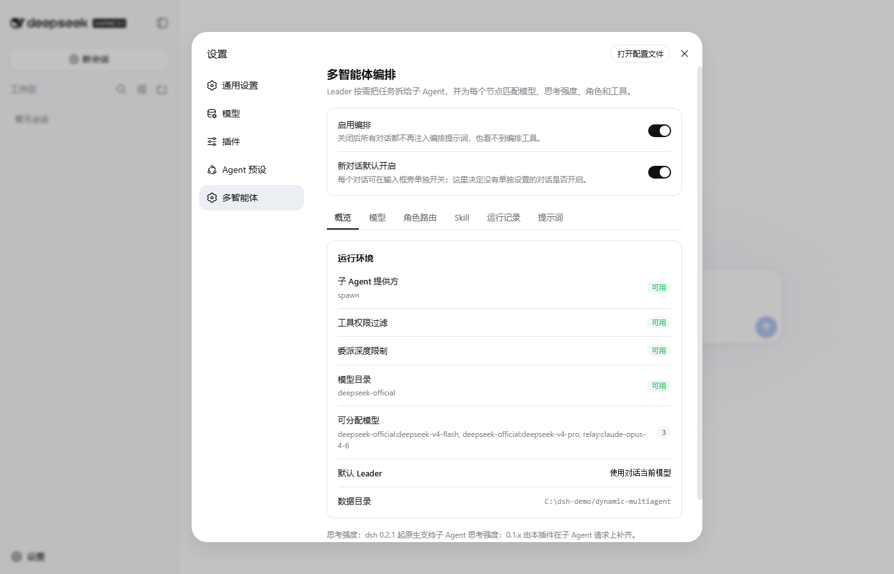
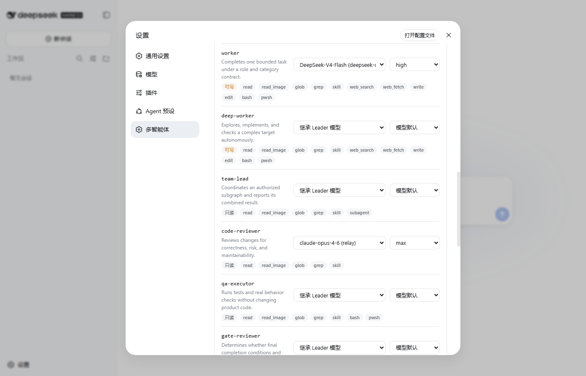
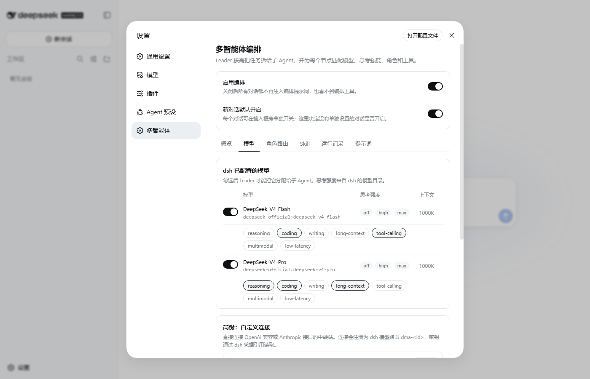
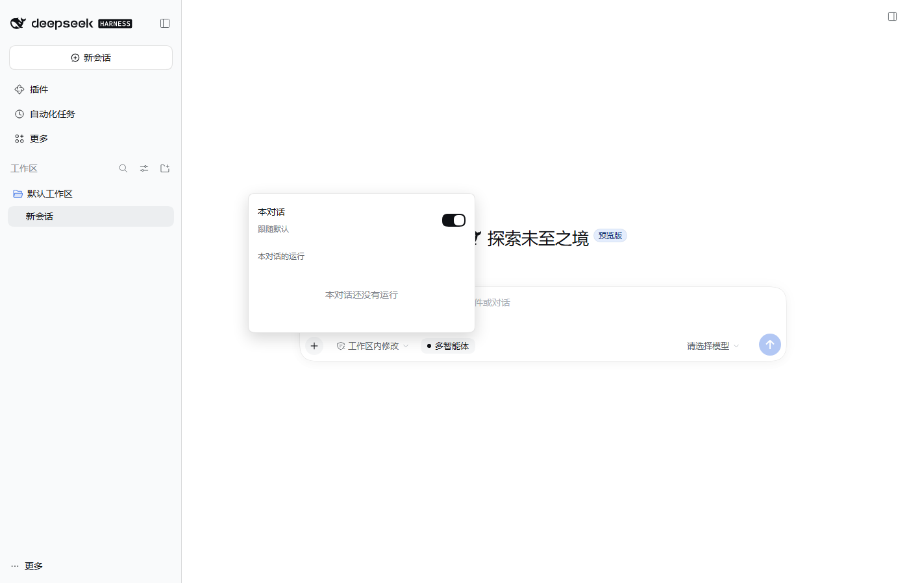
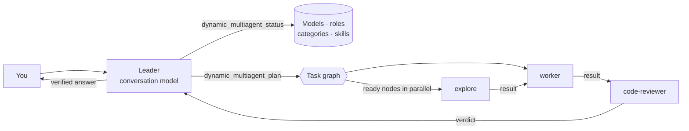

<div align="center">


# dsh-dynamic-multiagent

**Dynamic multi-agent orchestration for [DeepSeek Harness](https://github.com/deepseek-ai/deepseek-harness)**

The conversation's model becomes a Leader that can split a task into a graph of child agents,<br>
each with its own role, model, reasoning effort, and tool set.

English | [中文](README.zh.md)


</div>

<p align="center"></p>

## Features

- **Delegation on demand** — the Leader prompt tells the model when splitting a task pays off (independent sub-tasks, distinct expertise, independent review, large reading jobs) and when to just do the work itself.
- **Task graphs** — acyclic dependency graphs run ready nodes in parallel; a node receives its dependencies' results. Parallel, pipeline, execute-and-review, and multi-level team patterns are supported.
- **Roles that map to real tools** — 13 built-in roles (explore, librarian, worker, code-reviewer, qa-executor, …). Each child gets only its role's dsh tools (`read`, `grep`, `edit`, `bash`, `web_search`, …); reviewers are read-only and return a structured verdict.
- **Per-node model and reasoning effort** — route by node, role, or task category. Efforts are validated against what each model actually offers.
- **Settings page** — health check, model selection, routing table, skills, run history with a task-graph view, and a preview of the exact prompts.
- **Global and per-conversation switches** — turn orchestration off everywhere, or per conversation from the composer.
- **Custom connections (advanced)** — call an OpenAI-compatible or Anthropic endpoint directly, registered as a dsh model route.
- **Recoverable runs** — plans, assignments, results, and events are persisted; runs can be inspected and cancelled from the UI.

## Screenshots

| Overview | Routing |
|---|---|
|  |  |
| **Models and reasoning effort** | **Per-conversation switch** |
|  |  |

## Install

### DeepSeek Harness Desktop

Open **Plugins → Add plugin**, enter `dsh-dynamic-multiagent`, and confirm. The plugin page appears under **Installed plugins**.

> Installing with `dsh plugin --profile web add …` on a machine with Desktop installs into the CLI's `web` profile, not into Desktop. Use the in-app installer for Desktop.

### dsh CLI (web profile)

```sh
dsh plugin --profile web add dsh-dynamic-multiagent
dsh web
```

Open **Settings → Multi-agent** (多智能体).

### From source

```sh
git clone https://github.com/Silasvanceneo/dsh-dynamic-multiagent.git
cd dsh-dynamic-multiagent
npm install && npm run build
dsh plugin --profile web add /absolute/path/to/dsh-dynamic-multiagent
```

## Quick start

1. Open the settings page. **Overview** should show the subagent provider (`spawn`) as ready.
2. On **Models**, switch on the dsh models children may use and tag their capabilities. Skip this step and every child inherits the conversation's model.
3. On **Routing**, optionally pick a model and reasoning effort per role or category, for example a cheap model with effort `off` for `explore` and a strong one with `max` for `code-reviewer`.
4. Give the conversation a task that benefits from splitting, for example *"Survey how errors are handled across this repository, fix the three worst cases, and have the fixes reviewed independently."*

The Leader reads the catalog, submits a plan, tells you the plan in one or two sentences, runs it, verifies the results, and reports back. Progress shows in the composer chip and on the **Runs** tab.

## How it works



| Tool | Purpose |
|---|---|
| `dynamic_multiagent_status` | Without a run id: available models (with efforts), routing defaults, roles, categories, skills. With a run id: graph, results, events. |
| `dynamic_multiagent_start` | Opens a run and records the user's constraints. |
| `dynamic_multiagent_plan` | Validates the graph (ids, acyclic dependencies, roles, models, efforts) and returns each node's model and effort. |
| `dynamic_multiagent_execute` | Runs the graph through the host's `ctx.subagents` provider. |
| `dynamic_multiagent_derive_role` | Derives a specialized role that may only narrow its base role's tools, write access, and delegation. |
| `dynamic_multiagent_cancel` | Cancels a run and every unfinished child. |

Each child is a regular dsh subagent, so it shows up in dsh's own subagent views. It receives a role-specific prompt — not the Leader's — with its task, acceptance criteria, real tool names, write scope, and a fixed report format.

## Reasoning effort

A node's effort is resolved in this order: the node's `effort` → the role default → the category default → the model's own default.

| Source | Where the efforts come from | On the wire |
|---|---|---|
| dsh model | `ctx.llm.resolveModelInfo()`, for example DeepSeek `off · high · max` | the dsh adapter's own mapping |
| Custom connection, OpenAI-compatible | declared per model | `reasoning_effort` |
| Custom connection, Claude 4.6+ / Fable | declared per model (*Suggest from id*) | `thinking: {type: "adaptive"}` + `output_config.effort` |
| Custom connection, Claude 4.5 and older | declared per model | `thinking.budget_tokens` |

An explicit effort the model does not offer is rejected when the plan is submitted; an unsupported *default* is dropped with a note. dsh 0.2.x applies a child's `reasoningEffort` natively. dsh 0.1.x children only inherit provider, model, and output cap, so the plugin re-applies the effort on every request of that child.

## Switches

| Switch | Where | Effect |
|---|---|---|
| Enable orchestration | top of the settings page | Off: no conversation gets the Leader prompt or the six tools. |
| On for new conversations | top of the settings page | Default for conversations without their own setting. |
| This conversation | **Multi-agent** chip next to the composer | Per-conversation override; *Follow default* clears it. |

When orchestration is off for a conversation, the Leader prompt section is not rendered and the tools are masked for that agent, so the model never sees them. Overrides are stored in the plugin's data directory, not in the dsh session log, so logs stay readable if the plugin is removed. Child agents never see the orchestration tools.

## Configuration

Settings are edited in the UI and stored in `${DSH_HOME}/dynamic-multiagent/config.json` (`~/.dsh` by default). Deployment options go in the profile's `cordis.patch.yml`:

```yaml
- id: dynamic-multiagent
  config:
    dataDir: ${DSH_HOME}/dynamic-multiagent   # where config, runs, and switches live
    subagentProvider: spawn                    # host subagent provider used for children
    exposeTools: true                          # false hides the six tools entirely
    autoInstallSkills: false
```

Custom connections never store secrets: `credentialRef` names an environment variable or dsh credential, such as `RELAY_API_KEY`.

## Compatibility

| Host | Settings page | Browser ↔ host channel |
|---|---|---|
| dsh 0.1.0-rc.6 (CLI) | Settings → Multi-agent | loopback `/dynamic-multiagent/*` |
| dsh 0.2.1-rc.3 (Desktop) | Plugins → Dynamic multi-agent | authenticated `/api/dynamic-multiagent/*` |

The settings page, switches, model catalog, and saving were exercised in the real Web UI of both versions. A full end-to-end delegation against a live model provider is not yet covered by automated tests.

## Development

```sh
npm install
npm run build    # client/ → lib/client.js (React, slots, and primitives come from the dsh shell)
npm test         # node --test
npm run check    # build + syntax check + tests
```

| Path | Contents |
|---|---|
| `src/index.js` | Host plugin: prompt section, tools, switches, effort bridge, settings channel |
| `src/core/` | Runtime, model routing, roles, prompts, task graph, persistence, connection adapter |
| `client/` | Browser half: settings page, composer chip, tool cards |
| `docs/design/` | Original design documents (Chinese) |

## License

[MIT](LICENSE)
