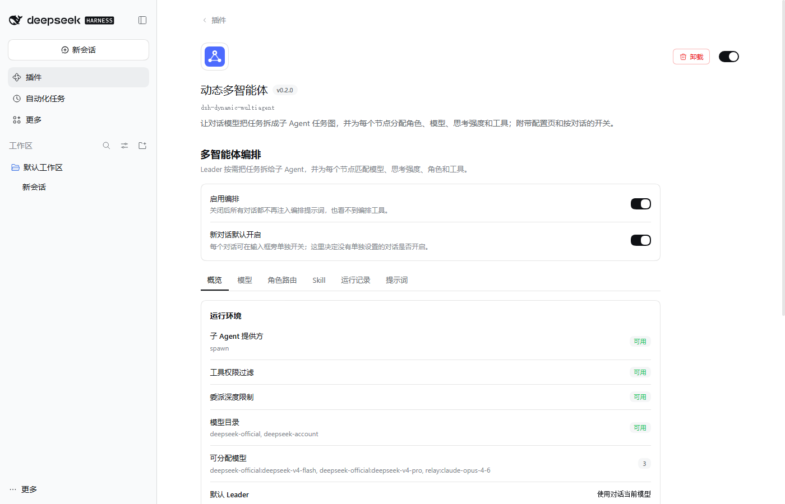
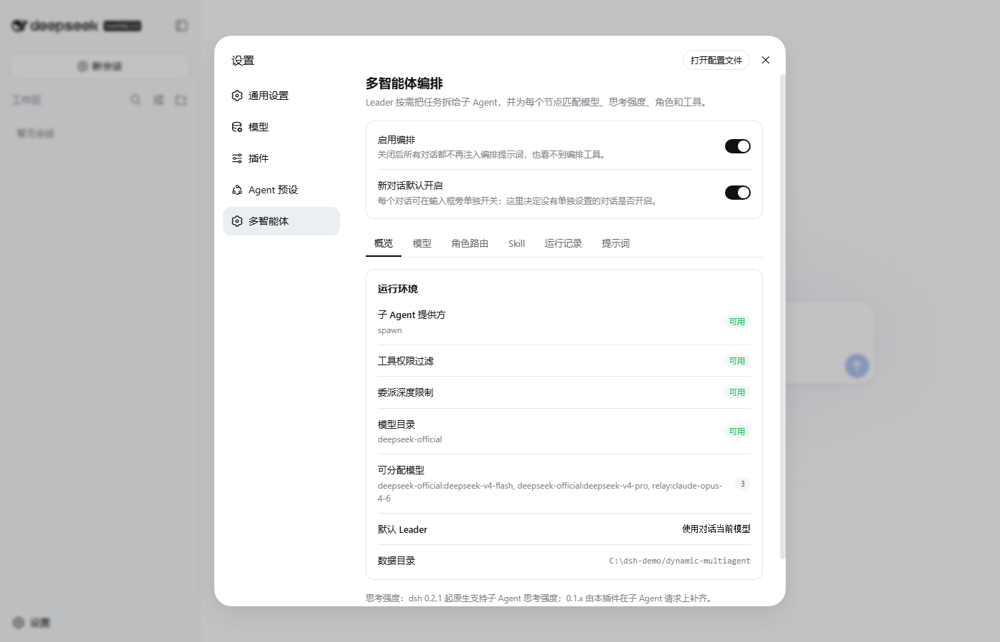
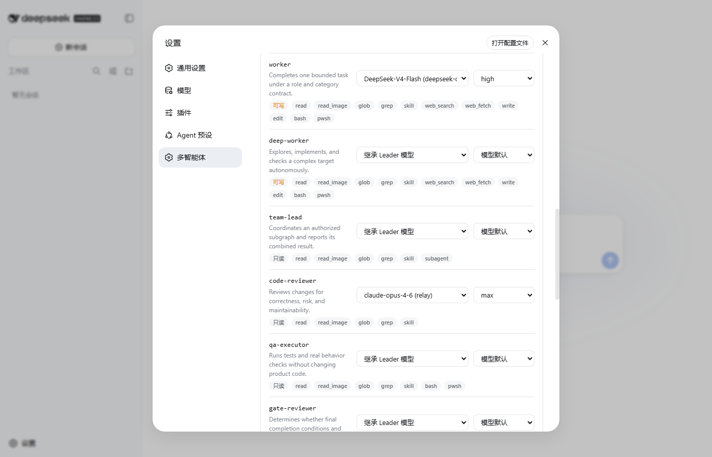
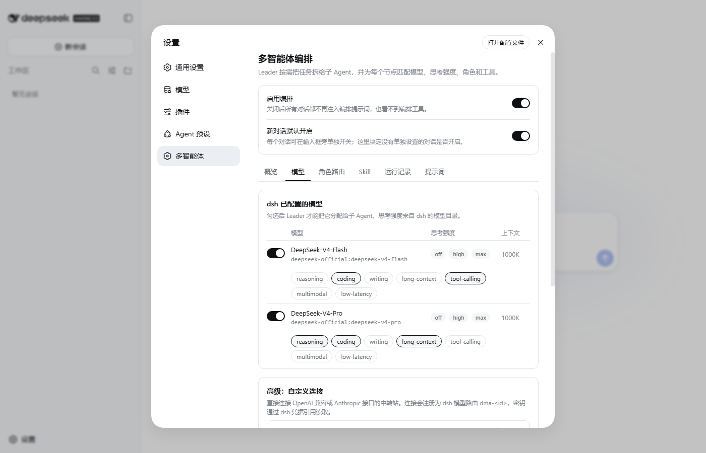
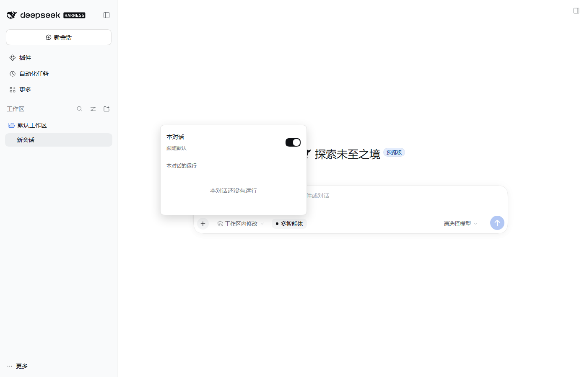
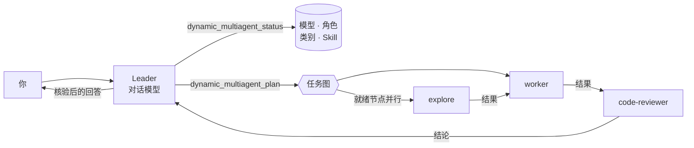

<div align="center">


# dsh-dynamic-multiagent

**为 [DeepSeek Harness](https://github.com/deepseek-ai/deepseek-harness) 提供动态多智能体编排**

对话模型成为 Leader，可以把任务拆成子 Agent 任务图，<br>
并为每个节点分配角色、模型、思考强度和工具。

[English](README.md) | 中文


</div>

<p align="center"></p>

## 功能

- **按需分工**：Leader 提示词写明什么时候值得拆（子任务互相独立、需要不同专长、需要独立审查、要读大量资料），什么时候自己做更快。
- **任务图**：无环依赖图，就绪节点并行执行，下游节点自动拿到上游结果；支持并行分工、流水线、执行加审查、多层团队。
- **角色对应真实工具**：内置 13 个角色（explore、librarian、worker、code-reviewer、qa-executor……），每个子 Agent 只拿到本角色的 dsh 工具（`read`、`grep`、`edit`、`bash`、`web_search`……）；审查类角色只读，并返回结构化结论。
- **按节点选模型和思考强度**：可按节点、角色、任务类别分别设置；强度会按模型实际支持的档位校验。
- **配置页**：运行环境检查、模型选择、路由表、Skill、带任务图的运行记录，以及实际提示词的预览。
- **全局开关和对话开关**：可以全部关闭，也可以在输入框旁单独关闭某个对话。
- **自定义连接（高级）**：直连 OpenAI 兼容或 Anthropic 接口，注册为 dsh 模型路由。
- **可恢复的运行**：计划、分配、结果和事件都会持久化，可在界面里查看和取消。

## 截图

| 概览 | 角色路由 |
|---|---|
|  |  |
| **模型与思考强度** | **对话开关** |
|  |  |

## 安装

### DeepSeek Harness 桌面端

打开 **插件 → 添加插件**，输入 `dsh-dynamic-multiagent` 并确认。安装后在 **已安装插件** 里进入插件页。

> 装了桌面端的电脑上，用 `dsh plugin --profile web add …` 安装进的是命令行的 `web` profile，桌面端看不到。桌面端请用应用内的安装入口。

### dsh 命令行（web profile）

```sh
dsh plugin --profile web add dsh-dynamic-multiagent
dsh web
```

打开 **设置 → 多智能体**。

### 从源码安装

```sh
git clone https://github.com/Silasvanceneo/dsh-dynamic-multiagent.git
cd dsh-dynamic-multiagent
npm install && npm run build
dsh plugin --profile web add /插件目录的绝对路径
```

## 快速上手

1. 打开配置页，**概览** 里子 Agent 提供方（`spawn`）应显示为可用。
2. 在 **模型** 页打开允许子 Agent 使用的 dsh 模型，并标注能力。跳过这一步也行，子 Agent 会沿用对话当前的模型。
3. 在 **角色路由** 页按角色或任务类别指定模型和思考强度，例如 `explore` 用便宜模型、强度 `off`，`code-reviewer` 用强模型、强度 `max`。
4. 给对话一个值得拆分的任务，例如：“梳理这个仓库的错误处理方式，修掉最糟的三处，并让修改经过独立审查。”

Leader 会先读取模型和角色目录、提交计划、用一两句话说明计划，然后执行、核验结果并汇报。进度可以在输入框旁的按钮和 **运行记录** 页查看。

## 工作方式



| 工具 | 作用 |
|---|---|
| `dynamic_multiagent_status` | 不带 runId：可用模型（含思考强度）、路由默认值、角色、类别、Skill；带 runId：任务图、结果和事件。 |
| `dynamic_multiagent_start` | 创建一次运行，记录用户约束。 |
| `dynamic_multiagent_plan` | 校验任务图（节点 id、无环依赖、角色、模型、强度），返回每个节点分到的模型和强度。 |
| `dynamic_multiagent_execute` | 通过宿主的 `ctx.subagents` 执行任务图。 |
| `dynamic_multiagent_derive_role` | 从内置角色派生专用角色，只能收窄工具、写权限和委派范围。 |
| `dynamic_multiagent_cancel` | 取消运行，并停止所有未完成的子 Agent。 |

每个子 Agent 都是普通的 dsh 子智能体，会出现在 dsh 自带的子智能体视图里。它拿到的是按角色组装的提示词（不是 Leader 的），包含任务、验收条件、真实工具名、可写范围和固定的回报格式。

## 思考强度

节点强度按以下顺序决定：节点的 `effort` → 角色默认 → 类别默认 → 模型自身默认。

| 模型来源 | 强度档位从哪来 | 实际请求参数 |
|---|---|---|
| dsh 模型 | `ctx.llm.resolveModelInfo()`，例如 DeepSeek 为 `off · high · max` | 由 dsh 适配器自行映射 |
| 自定义连接：OpenAI 兼容 | 按模型声明 | `reasoning_effort` |
| 自定义连接：Claude 4.6 及以上 / Fable | 按模型声明（可用“按模型推荐”） | `thinking: {type: "adaptive"}` + `output_config.effort` |
| 自定义连接：Claude 4.5 及更早 | 按模型声明 | `thinking.budget_tokens` |

计划里显式写了模型不支持的强度，提交时直接报错；默认值不受支持时会被忽略并附说明。dsh 0.2.x 原生支持子 Agent 的 `reasoningEffort`；dsh 0.1.x 的子 Agent 只继承提供方、模型和输出上限，由插件在该子 Agent 的每次请求上补上强度。

## 开关

| 开关 | 位置 | 效果 |
|---|---|---|
| 启用编排 | 配置页顶部 | 关闭后所有对话都没有 Leader 提示词和这 6 个工具。 |
| 新对话默认开启 | 配置页顶部 | 决定没有单独设置的对话是否开启。 |
| 本对话 | 输入框旁的“多智能体”按钮 | 单个对话的开关；“跟随默认”可清除单独设置。 |

对话关闭编排后，Leader 提示词段不会渲染，工具也会对该 Agent 屏蔽，模型完全看不到。开关状态存在插件自己的数据目录，不写入 dsh 会话日志，卸载插件后旧会话照样能打开。子 Agent 永远看不到编排工具。

## 配置

配置在界面里修改，保存在 `${DSH_HOME}/dynamic-multiagent/config.json`（默认 `~/.dsh`）。部署相关选项写在 profile 的 `cordis.patch.yml`：

```yaml
- id: dynamic-multiagent
  config:
    dataDir: ${DSH_HOME}/dynamic-multiagent   # 配置、运行记录和开关状态所在目录
    subagentProvider: spawn                    # 执行子 Agent 的宿主提供方
    exposeTools: true                          # false 时完全不注册这 6 个工具
    autoInstallSkills: false
```

自定义连接不保存密钥：`credentialRef` 填环境变量名或 dsh 凭据名，例如 `RELAY_API_KEY`。

## 兼容性

| 宿主 | 配置页位置 | 浏览器与宿主的通道 |
|---|---|---|
| dsh 0.1.0-rc.6（命令行） | 设置 → 多智能体 | 仅本机的 `/dynamic-multiagent/*` |
| dsh 0.2.1-rc.3（桌面端） | 插件 → 动态多智能体 | 需登录态的 `/api/dynamic-multiagent/*` |

配置页、开关、模型目录和保存已在两个版本的真实界面中实测。完整的端到端分工（真实模型调用）还没有自动化测试覆盖。

## 开发

```sh
npm install
npm run build    # client/ → lib/client.js（React、slots、primitives 由 dsh 外壳提供）
npm test         # node --test
npm run check    # 构建 + 语法检查 + 测试
```

| 路径 | 内容 |
|---|---|
| `src/index.js` | 宿主插件：提示词段、工具、开关、思考强度补齐、配置页通道 |
| `src/core/` | 运行时、模型路由、角色、提示词、任务图、持久化、连接适配器 |
| `client/` | 浏览器端：配置页、输入框按钮、工具卡片 |
| `docs/design/` | 最初的设计文档 |

## 许可证

[MIT](LICENSE)
