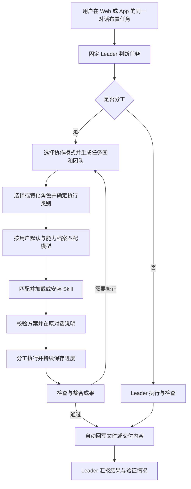

# dsh 动态多智能体编排插件任务书

版本：v1.3，内置系统提示词与按需自动注入  
日期：2026-11-09  
目标宿主：DeepSeek Harness（dsh）Web 与 Desktop App  
当前阶段：需求已确认，尚未开始插件开发  
版本依据：本机 CLI 为 `0.1.0-rc.6`；Desktop 运行时版本须在实施前核对

## 1. 项目目标

实现一个可接入第三方中转站 API 的 dsh 动态多智能体编排插件，面向编程、调研、分析、写作等通用任务，不预设某一种场景优先。

用户始终通过一个对话框与自己选定的 Leader 模型交流。Leader 判断任务是否需要分工：简单任务自行处理，复杂任务选择协作方式、建立任务关系、分配职责，为子 Agent 匹配模型和 Skill，并组织执行、验收和结果整合。

首版同时支持 Web 与 dsh Desktop App，两端功能一致、各自运行任务；首版必须支持任务进度持久化与重启恢复。用户不需要切换子 Agent 对话，也不需要逐次批准分工方案。

“动态”必须体现在是否分工、如何协作、任务分配、模型与 Skill 匹配，以及执行中根据实际结果调整计划。基础角色无法充分表达任务专长时，Leader 还可继承基础角色，生成包含特化提示词和明确执行合同的新 Agent 定义。

## 2. 用户已确认的决策

| 编号 | 事项 | 确认结论 |
| --- | --- | --- |
| D01 | 任务类型 | 通用任务，编程、调研、分析、写作等场景同等重要。 |
| D02 | API 协议 | 首版同时支持 OpenAI 兼容接口和 Anthropic Messages。具体中转站与模型由用户配置。 |
| D03 | Leader | 用户选择模型，运行过程中保持固定，不自动切换。 |
| D04 | 分工确认 | Leader 在同一对话说明方案后直接执行，无须每次确认。 |
| D05 | 合作方式 | 基础的并行分工、流水线、执行与审查，以及完整任务依赖图、多层级团队均属首版要求。 |
| D06 | 模型选择 | 用户可指定默认模型；Leader 依据预先调研的能力档案匹配。指定模型明显不适合时提出建议，不能据此自行改用其他模型。 |
| D07 | Skill 来源 | 已安装技能、本地目录或 Git 仓库导入，以及 Leader 自动发现与安装，三种均需支持。 |
| D08 | 资源额度 | 不设置费用、并发、总 Agent 数、团队深度或总运行时间的产品额度上限。 |
| D09 | Git 隔离 | 使用插件私有 Git 仓库与原生 worktree，在项目之外管理 Agent 工作区，无须修改 Git 程序源码。 |
| D10 | 文件交付 | 检查通过后自动回写成果文件，保持原项目分支、历史和暂存区不变。 |
| D11 | 运行入口 | Web 与 Desktop App 都必须支持。 |
| D12 | 恢复 | 首版必须支持关闭或重启后的任务恢复。 |
| D13 | 两端关系 | 两端功能一致、各自运行即可，不要求跨端控制同一个运行中的任务。 |
| D14 | Agent 分类 | 参考 OmO，区分专职 Agent 角色与执行任务类别；角色、类别、模型、Skill 和协作拓扑分别配置。 |
| D15 | 动态特化方向 | 在基础角色上，由 Leader 按任务设计特化提示词、上下文、Skill 与检查方法；新角色必须继承原有模型选择、权限与工作区规则。 |
| D16 | 内部提示词 | 编排与 Agent 特化指令由插件内置为系统提示词，按职责和阶段自动组装注入，用户只需正常布置任务。 |

“直接执行”适用于分工和已授权任务，仍遵守 dsh 宿主与父任务的实际权限；加载 Skill 不会扩大权限。

## 3. 必须实现的能力

| 编号 | 能力 | 用户可观察到的结果 |
| --- | --- | --- |
| R01 | 单对话框入口 | 布置、补充要求、查看进度、取消和获取结果均通过 Leader 对话。 |
| R02 | 双协议中转站 | 可配置多个连接和模型，实际调用两种协议。 |
| R03 | 固定 Leader | 所选 Leader 持续承担用户入口，不被自动替换。 |
| R04 | 判断是否分工 | 简单任务直接处理，协作收益明确的任务才创建子 Agent。 |
| R05 | 动态协作 | 根据任务选择或组合五种首版协作机制。 |
| R06 | 职责与任务图 | 每个节点有输入、责任、输出、依赖和完成条件；支持多层级团队。 |
| R07 | 模型匹配 | 尊重用户默认配置，未指定时动态选择；不适配时给出有依据的建议。 |
| R08 | Skill 匹配 | 根据子任务加载不同技能，支持三种来源和按需自动安装。 |
| R09 | 执行与整合 | 调度任务、传递成果、解决依赖并汇总交付。 |
| R10 | 结果核验 | 检查成果、产生缺陷和定向返工，明确报告未完成项。 |
| R11 | Git 隔离与回写 | Agent 在私有 worktree 工作，通过检查后自动写回文件，不改原 Git 元数据。 |
| R12 | 持久化与恢复 | 重建任务图、团队、成果及未完成工作，避免重复副作用。 |
| R13 | Web/App 一致性 | 两端都可完成全部流程，各自运行，不要求共用运行服务。 |
| R14 | 进度与干预 | 展示模型、Skill、任务状态，接受补充要求和取消。 |
| R15 | 无产品额度上限 | 不因内置费用、并发、深度或总时长配额停止正常工作；展示真实或估算用量。 |
| R16 | OmO 式 Agent 分类 | 按明确角色调用规划、探索、研究、执行、审查等 Agent，执行者再按任务类别匹配模型与 Skill。 |
| R17 | Leader 动态特化 | Leader 能复用、派生或创建任务所需的专职角色，并生成可校验、可追踪的提示词与执行合同；通过实际结果验证特化效果。 |
| R18 | 系统提示词自动装配 | 内置 Leader 基础指令及阶段模块，自动为 Leader 和子 Agent 配置所需系统指令；无需用户粘贴提示词、输入模式关键词或手动切换角色。 |

## 4. 用户流程

1. 用户在 Web 或 App 中配置中转站、模型、角色/任务类别默认模型及可用 Skill 来源。
2. 用户选择本次 Leader 模型，在原有对话框布置任务。
3. 插件自动装配 Leader 系统指令；Leader 按需读取上下文、模型能力摘要和技能目录，判断是否分工。用户不负责准备或发送编排提示词。
4. 简单任务由 Leader 直接处理；复杂任务生成包含合作方式、任务图、团队、Agent 角色、执行类别、模型、Skill 和验收条件的结构化方案。需要特定专长时，Leader 可从基础角色派生任务专职 Agent。
5. 插件校验方案，Leader 在对话中说明后直接执行。模型不适配、关键信息缺失等例外需要在原对话中说明或提问。
6. 子 Agent 获取自己的任务、必要上下文、所需 Skill 和独立工作区；按依赖执行并回报。
7. Leader 核验并整合结果，必要时修正任务图或定向返工。代码成果在私有集成工作区验证。
8. 通过检查的文件差异自动回写原项目；其他任务直接交付文档、分析或成果引用。
9. 中途关闭后，下次启动恢复可恢复的进度；用户可继续补充要求或取消。



## 5. 功能合同

### 5.1 中转站与模型连接

- 支持连接名称、`base_url`、协议、凭据引用、自定义请求头引用和实际模型 ID。一个连接可登记多个模型，多个连接可并存。
- OpenAI 兼容协议至少覆盖 Chat Completions；Anthropic 覆盖 Messages。Responses 等额外接口按具体站点需要扩展，不以“兼容”概括所有差异。
- 模型身份使用“连接 ID + 实际模型 ID”；DeepSeek、GPT、Claude 是来源示例，不硬编码固定品牌列表。
- 支持手工配置和配置文件导入；支持模型列表接口的站点可辅助发现，不支持时仍能使用手工配置。
- 两种协议均处理流式文本、工具调用、工具结果、取消、错误、上下文约束及可获得的用量信息。
- 分别检测鉴权失败、模型不存在、限流、网络故障和参数/工具不兼容。需要执行工具的任务不得分配给只支持文本的路由。
- 凭据复用 dsh 凭据能力或安全引用，不进入提示词、普通日志或导出的编排计划。

### 5.2 模型能力调研与路由

- 开发早期交付模型能力档案：具体版本与路由、适合任务、已验证能力、限制、参考来源、调研日期及证据强度。
- 对推理、编程、写作、长上下文、工具调用、多模态、延迟等分别描述；官方声明、实际验证与推断分开记录。
- 中转站别名未确认映射时标为待核对。品牌印象、宣传名称和缺少来源的“最强领域”不能直接作为自动路由依据。
- 用户可以按角色、任务类别或具体任务指定默认模型。没有指定的节点，由 Leader 从满足任务条件的可用模型中选择。
- 用户指定模型优先。Leader 判断它明显不适合时，解释原因、推荐替代项及证据；实际改用替代模型需要用户同意。用户同意可以作为后续同类任务的规则。
- Leader 在本次运行内保持固定。Leader 故障时保存进度并报告等待恢复，不自动换模型。
- 子 Agent 也不得借故障回退绕过用户指定；未指定节点可在符合能力及用户允许连接范围内选择替代模型，并记录变更。
- 路由选择和实际执行模型都需要记录；模型切换只发生在明确的任务或请求边界。

### 5.3 判断是否分工与规划

- 综合工作量、独立子任务、依赖、未知程度、检查必要性、可并行收益及额外开销判断是否分工。
- 不以关键词或请求长度作为唯一依据；对局部、简单、拆分收益低的任务由 Leader 自己处理。
- 计划必须包含目标、选择理由摘要、合作模式、任务节点、责任、模型、Skill、输入输出、依赖、验收条件及与用户约束的关联。
- 校验模型和技能存在性、调用能力、工具权限、依赖图无环、父子团队归属、文件责任及资源可用性。
- 校验通过后说明方案并执行，不等待常规分工批准。仅对实质缺失信息、指定模型不适配、成果冲突等例外询问。
- 执行中可以调整任务和模式，保留已通过且仍适用的成果，记录新计划版本与变更原因。

### 5.4 首版协作方式

| 机制 | 合作方式 | 必须满足的行为 |
| --- | --- | --- |
| 并行分工 | 独立子任务同时执行，Leader 合并 | 输入和责任明确，独立写入相互隔离。 |
| 流水线 | 上游成果成为下游输入 | 前置完成条件未满足时，不启动依赖任务。 |
| 执行与审查 | 执行者提交、审查者核验、定向修正 | 审查有证据，不能将提交声明直接当成通过。 |
| 完整任务依赖图 | 按依赖调度，支持并行、汇合、分支失败、重试、重规划与结果复用 | 检查循环依赖，保存计划版本与节点关系，恢复后仍能正确调度。 |
| 多层级团队 | Leader 委派组长，组长进一步拆分并组织成员 | 始终保留顶层 Leader 用户入口，团队归属与成果汇报可追踪，避免重复委派。 |

五种机制均属首版必交能力，可以组合使用。不设置固定团队层级配额。多人讨论与裁决可作为后续可选机制，尚未列为本版必交内容。

任务图使用无环依赖表达同一计划版本；返工通过新尝试或新计划版本表达，不用依赖环模拟无限循环。对非编程任务也支持图与团队机制。

### 5.5 Skill 发现、导入、安装与加载

- 同时支持：读取 dsh 已安装技能；导入指定本地目录或 Git 仓库；Leader 根据任务自动搜索、选择并安装缺少的技能。
- 保留来源、版本或提交标识、内容摘要、安装位置、资源与依赖信息，确保选中的版本可追踪、可恢复。
- 自动搜索与安装属于已授权产品流程，不为每个普通 Skill 安装额外添加确认；需要新增凭据、付费或扩大宿主权限时遵守对应边界。
- 自动安装默认使用插件管理的技能目录和依赖环境，再注册到 dsh；不向用户项目塞入无关文件或改变项目依赖。
- 先向 Leader 提供目录摘要，确定分配后再为对应 Agent 加载技能正文与必要资源。
- 可以为一个 Agent 分配零个、一个或多个 Skill，检查指令冲突、工具需求和实际可用能力。
- 尊重技能的调用策略。安装或加载 Skill 不等于获得额外执行权限。
- 缺失、下载失败、版本不兼容、依赖不足或模型无法使用所需工具时，报告具体原因并重新匹配，不伪装成已加载。
- 保存 Skill 版本快照与绑定关系；运行中来源更新不应静默改变已启动任务的指令。

### 5.6 调度与团队协作

- 每个节点携带必要输入、明确任务、预期输出、完成条件和权限；节点间优先交换摘要、证据与成果引用。
- 不把所有 Agent 的完整聊天记录相互复制。组长负责组内整合，顶层 Leader 负责用户目标和最终结果。
- 无产品级并发、数量、深度或总时长配额；调度根据当前任务图、可用内存/进程/连接及中转站限流决定可运行工作，其余任务排队。
- 供应商并发限制和 `Retry-After` 必须遵守，系统资源不足时降低启动速度，不将其误报为用户额度不足。
- 请求连接、断流检测和故障处理属于通信机制，不构成整个任务的运行时长上限。
- 可恢复错误按状态处理，永久错误不盲目重试；持续不可用、无进展或重复委派需报告阻塞并调整计划，不按固定额度静默停止。
- 用户补充要求必须由 Leader 纳入决策，明确影响哪些任务；取消须停止调度并向所有后代任务传播停止信号。
- 完成后的子 Agent、进程与临时资源及时释放；恢复所需的状态和成果独立保存。

### 5.7 Git 隔离与成果回写

采用用户已确认的“插件私有仓库 + 原生 worktree + 文件差异回写”方案。普通 `git worktree` 会在所属仓库写入管理记录，因此工作树必须属于插件私有仓库，不能直接挂在原项目仓库下。凡需写入项目文件的 Leader 任务也遵守该隔离与回写流程。

1. **读取基线**：记录用户当前工作区快照，包含任务所需的已提交内容、暂存和未暂存的文件状态、必要的未跟踪文件。保留原索引与 Git 状态，不重置或清理用户修改。
2. **创建私有仓库**：在插件数据目录建立独立 Git 管理目录与对象存储。项目 `.git`、其指针和嵌套仓库元数据不作为普通任务文件复制。子模块、嵌套仓库、LFS、符号链接与忽略资源需要显式处理规则，不静默丢失。
3. **分配 worktree**：有文件写入职责的 Agent 在私有仓库的独立 worktree 执行。分支、提交、合并和恢复点均归插件私有仓库管理。
4. **私有集成**：把成果汇入私有集成工作区，检查冲突并执行任务对应的验证。需要修正时在私有区域完成。
5. **自动回写**：通过检查后，以最初基线、当前原工作区、集成成果进行三方比较，将适用文件差异写回原工作区。
6. **保护并发编辑**：保留用户在任务期间的新修改。写前核对受影响路径，写入时记录日志；有冲突的部分不得覆盖用户内容，交由 Leader 解释并解决。
7. **保持原 Git 不变**：不切换原分支，不改原 refs/提交历史/配置/钩子/索引，不向原项目注册 worktree，不自动暂存或提交。原项目未使用 Git 时，也不在其目录初始化 Git。
8. **可恢复写入**：多文件回写采用有日志、可核对、可恢复的流程，不宣称文件系统提供跨文件原子事务。中断后核对哪些文件已写入，再继续或撤回仅由本任务写入且未被用户继续修改的部分。

文件回写会形成正常的未提交文件差异，这是交付结果；用户原有的暂存内容、分支和历史保持原状。普通任务无需用户逐次批准回写；冲突或无法核实的路径除外。

### 5.8 验收、返工与结束

- 开始前定义完成条件；节点提交后依据实际证据检查，不依赖“已完成”口头声明。
- 编程检查适用的构建、测试和实际行为；调研检查来源和覆盖；写作检查结构、事实与用户约束；其他任务定义对应标准。
- 审查缺陷包含问题、证据和修正目标，支持定向返工，保留仍有效的成果。
- 不设置固定审查轮数配额；依据可解决问题和实际进展继续。条件不足、持续无进展或用户取消时报告准确状态，避免机械重复。
- 成功须满足所需任务与验收条件。最终答复包含成果、位置、验证情况和剩余事项；失败、阻塞、取消不能显示为成功。

### 5.9 进度、持久化与重启恢复

- 在同一对话中展示当前阶段和简洁进度，可展开查看任务图、团队、模型、Skill、成果与错误。
- 持久化计划版本、任务依赖、父子团队、模型与技能绑定、执行尝试、结果、审查、工作区和回写进度。
- 运行状态与进程存活分开判断。重启不意味着已开始的外部请求或命令一定失败，也不意味着可以直接重放。
- 恢复时重新核对依赖、工作区、成果及未决操作；恢复待执行节点，复用有效成果，对不确定副作用标记待核对。
- 外部写操作若没有可靠幂等性，不自动重试不确定的调用；向用户报告需要核对的情况。
- 保存必要的上下文摘要和已确认约束，不要求把完整聊天记录复制到每个子 Agent。
- 关闭界面与后台运行服务退出分别处理：界面关闭不必然中止任务；Host/服务退出前保存状态，意外退出后依靠已持久化检查点恢复。具体宿主能力在实现阶段验证。

### 5.10 Web 与 Desktop App

- 复用同一插件核心、配置约定和客户端业务组件，分别适配 Web 与 Desktop 的安装与启动方式。
- 两端都支持 API 配置、Leader 对话、任务图/团队进度、Skill 管理、取消、成果交付及恢复。
- Desktop 使用自身捆绑运行时与 Profile，不能假定 npm CLI 安装插件后 Desktop 自动激活。
- 两端各自运行，不要求同一进行中任务跨端接续；进度与执行归属于各自的运行实例，不能重复认领执行。
- 实施前核对 CLI 与 Desktop 的实际版本和扩展接口，记录兼容范围，分别完成实际界面验证。

### 5.11 用量展示

- 展示 Leader、组长、执行者、审查者及重试的可获得用量，不设置默认费用或总 token 额度。
- 中转站未返回的 token、价格或金额标记为未知或估算，区分模型公开价格和中转站实际计价。
- 成本可以作为 Leader 判断是否有必要分工的信息，但不会因为产品内置金额阈值阻止用户任务。

### 5.12 OmO 式 Agent 角色与执行类别

本插件参考 OmO 的两层分类：一层是有明确职责和工具策略的专职 Agent，另一层是执行者所承接的任务类别。角色决定责任与可用操作，类别决定任务侧重点，模型提供推理能力，Skill 提供具体知识和操作流程，协作拓扑决定成员如何合作。

OmO 的不同版本命名不同。已核对的 OpenCode 版保留 Sisyphus、Hephaestus、Oracle、Metis、Momus、Atlas 等专职角色；Native 版使用 `explore`、`librarian`、`plan-consultant`、`plan-reviewer` 等功能名称及独立执行类别。下表是本插件的角色设计与参考对应关系，不宣称这些名称在 OmO 中全是可互换的正式别名。

#### A. 内置角色模板

| 本插件角色 ID | OmO 参考角色或机制 | 职责 | 默认操作范围 |
| --- | --- | --- | --- |
| `leader` | Sisyphus / Native main agent | 接收用户任务，判断难度，选择模式、角色和类别，调度、核验并统一交付 | 固定用户所选模型；允许编排及在私有工作区执行。 |
| `planner` | Prometheus / Native 同会话规划模式 | 形成目标、步骤、依赖、责任和验收条件 | 读取、研究和生成计划；不直接修改产品文件。可由 Leader 承担该职责。 |
| `plan-consultant` | Metis / Native plan-consultant | 查找遗漏、歧义、隐藏依赖和失败点 | 只读分析，向规划者返回问题与建议。 |
| `plan-reviewer` | Momus / Native plan-reviewer | 检查计划是否完整、可执行、可验证 | 只读审查计划，返回缺陷和判定；不自行改实现。 |
| `architecture-consultant` | Oracle / Native architect 类别中的咨询职责 | 架构取舍、复杂问题诊断和技术建议 | 默认只读咨询；需要实际改动时交给执行者。 |
| `explore` | Explore / Native explore | 搜索当前项目、定位实现、梳理文件与依赖 | 只读项目探索，输出可定位的证据。 |
| `librarian` | Librarian / Native librarian | 查询文档、外部资料和参考实现，整理来源 | 研究与检索，返回引用及适用范围，不修改产品文件。 |
| `multimodal-looker` | Multimodal Looker | 解读图像、界面截图和其他所支持媒体 | 使用具备相应输入能力的模型，输出观察和证据。 |
| `worker` | Sisyphus-Junior / Native category worker | 完成一个边界明确的任务，以类别和 Skill 定制执行 | 在分配的私有工作区内执行；默认不自行扩张委派。 |
| `deep-worker` | Hephaestus 的自主深入执行职责 / Native deep 类别 | 围绕复杂目标独立探索、实现和检查 | 以目标和验收条件驱动，在私有工作区执行；委派权限由计划明确赋予。 |
| `team-lead` | Atlas 的编排职责 | 管理被委派的子图或团队，汇总组内结果 | 只在授权子图内组织协作，向上级汇报；不取代顶层 Leader。 |
| `code-reviewer` | Native omo-native-code-reviewer | 审查代码变更的正确性、风险及维护问题 | 读取变更和验证证据，生成报告，不修改产品代码。 |
| `qa-executor` | Native omo-native-qa-executor | 执行测试、检查实际交互与成果行为 | 在隔离环境执行验证，可写报告和测试产物，不借验收修改产品实现。 |
| `gate-reviewer` | Native omo-native-gate-reviewer | 对照完成条件与证据核对最终是否可以交付 | 汇总验收、指出阻塞项，不以口头声明代替实际检查。 |

这些是可调用的角色模板，不要求每个任务都启动整套团队。简单任务由 Leader 自行执行；复杂任务按需要实例化对应角色，同一角色可有多个实例。规划相关角色在规划或重规划阶段调用。角色模板不要求新增用户对话框。

上述角色覆盖 OmO 的专职分类与通用任务需要的检查职责；`worker`、`deep-worker` 的任务可以是编程、调研、数据分析或写作，不能将它们固定理解为代码工人。

#### B. 执行任务类别

| 类别 ID | 侧重点 |
| --- | --- |
| `quick` | 边界清晰的小修改、整理、短任务。 |
| `visual-engineering` | 界面、前端、视觉呈现与交互实现。 |
| `writing` | 文档、报告、说明及其他文字产出。 |
| `ultrabrain` | 复杂推理、逻辑、算法与高难问题。 |
| `deep-low` | 一个明确目标下的常规自主深入执行。 |
| `deep-high` | 核心判断更复杂、需要更深入探索的自主执行。 |
| `artistry` | 创意、表达、设计探索与非常规方案。 |
| `architect` | 系统设计与跨模块技术判断；任务合同明确区分咨询和实际实现。 |
| `unspecified-low` | 其他类别未覆盖的一般任务。 |
| `unspecified-high` | 其他类别未覆盖的复杂任务。 |

类别名称参考 OmO，但不据此硬绑定模型厂商或具体型号。每个类别均可配置模型默认值、能力要求和 Skill 候选。`deep-low` / `deep-high` 表达任务执行方式，不是费用配额或固定 API 推理参数。

专职研究或审查角色可以只按角色调用，不强行指定执行类别。执行者可组合为“`worker` + `visual-engineering` + 用户指定模型 + 前端/无障碍 Skill”；同一角色也可承担不同类别。

#### C. 配置、选择与持久化约定

- 每个角色定义至少包含：稳定 ID、职责说明、角色提示词版本、工具策略、可写区域、输入输出合同、验收条件、Skill 候选、模型默认规则和委派策略。
- 分配顺序为：选择协作模式与任务 → 选择角色 → 必要时选择执行类别 → 应用用户模型配置 → 匹配 Skill 与工具 → 校验 → 执行。
- 子 Agent 的模型配置优先级为：具体任务指定 → 角色与类别组合默认 → 类别默认 → 角色默认 → Leader 依据能力档案选择。生效来源可查看；顶层 Leader 始终遵守本次固定选择。
- 所有默认模型仍受用户已确认的规则约束：明显不适合时给出建议，不能静默换模型。
- 角色工具策略必须实际约束工具调用，不能仅在提示词中写“只读”。报告、测试产物的写入与产品源文件修改分别约定。
- 审查者不修改被审查的产品实现，问题通过明确的返工任务交还执行者；组长只能操作其被授权的子图。
- 用户可配置角色默认模型和技能；Leader 也可按第 5.13 节派生具有明确合同的新角色。派生角色沿继承链查找用户默认配置，不靠新名称绕过角色权限或模型规则。
- 为每个实例保存 `agent_role`、可选的 `task_category`、角色定义版本、实际模型、Skill 版本与团队关系，恢复时重建同一职责合同。
- 非代码任务复用研究、执行、QA 和交付核验职责，按其成果标准检查，不强制运行与任务无关的代码测试。

### 5.13 Leader 动态设计与特化 Agent

本节是对固定角色目录的设计增补：OmO 式角色作为基础模板，Leader 可按任务生成更具体的派生角色。生成的是提示词、上下文和能力组合，不是在运行中训练新的底层模型；“更专业”的名称或更长的提示词本身不代表效果提升。

#### A. 三层角色定义

1. **基础职责**：继承 `worker`、`librarian`、`code-reviewer` 等已有角色，明确执行、研究或审查的责任与操作边界。
2. **领域特化**：增加真实任务所需的知识范围、工作方法、Skill、证据标准和常见错误。例如“数据结论核查”或“无障碍交互审查”。
3. **本次任务合同**：指定当前目标、输入、项目上下文、负责区域、依赖、交付格式和验收条件。

模型适配可以根据实际路由调整提示词表达和支持的输出格式，但必须保留同一目标、职责和验收条件。每层内容与版本可追踪，公共约束不交给模型任意改写。

#### B. Leader 的角色设计流程

1. 判断自己能否直接完成；若需要协作，先指出具体的专长缺口或独立职责。
2. 检索已有角色摘要。能够直接使用的先复用，需要领域差异的派生；确无合适基础角色时，生成符合执行/研究/审查合同的新定义。
3. 为角色生成简短、明确的专职提示词，写清目标、必要上下文、方法、工具、证据和交付标准。较大的领域知识放入按需加载的 Skill。
4. 应用用户模型默认配置并校验模型能力，选择或安装实际可用的 Skill，绑定工具和工作区。
5. 由插件校验定义，再接入任务图。新名字不能消除只读约束、获得新权限、修改固定 Leader 或绕过用户指定模型。
6. 执行后按既有标准验收。失败时先区分提示词、输入、能力、工具、Skill 或任务拆分问题，再有依据地调整对应部分。

对于合同清晰的普通派生角色，不额外要求用户批准。新角色不能自行变更需求、调用不存在的工具、加载未取得的技能，或因自己无法完成而降低验收条件。

#### C. 派生角色的最小合同

| 字段 | 内容 |
| --- | --- |
| `id` / `base_role` / `version` | 稳定标识、继承角色与定义版本；新建角色也必须选择执行、研究或审查的操作合同。 |
| `specialization` / `why_needed` | 具体专长与相对现有角色的必要差异。 |
| `objective` / `inputs` / `context_refs` | 本次目标、必需输入与可定位上下文。 |
| `prompt_sections` | 基础职责、领域方法、任务指令和模型适配片段；记录各部分来源。 |
| `tools` / `workspace` / `delegation` | 实际可用工具、写入范围、报告位置、委派规则；继承限制由宿主校验。 |
| `model_assignment` / `skills` | 按用户默认规则解析的模型、真实可加载的 Skill 及其版本。 |
| `deliverables` / `acceptance` | 交付物与不可擅自弱化的检查标准。 |
| `evidence_required` / `failure_behavior` | 必须提供的证据、缺失信息或失败时的报告和处理方式。 |

结构化定义是插件创建 Agent 的输入，提示词是由定义组装的模型指令。角色创建、校验和启动使用清晰的插件接口；具体工具名称在接口设计阶段确定，不能把拟议接口当成 dsh 已有 API。

#### D. 插件内置的 Leader 系统指令片段（开发参考）

以下内容由插件实现为内部系统提示词模板，并按第 5.14 节自动生效，供开发和评测参考，不是要求用户在对话框粘贴的操作步骤。它沿用既有固定 Leader 与模型配置规则：

```text
You coordinate tasks and design task-specific agents.
Solve bounded tasks yourself when delegation has no clear benefit.
Before adding an agent, identify the concrete responsibility or expertise it contributes.
Reuse an existing role when suitable; specialize a base role when the task needs distinct methods or evidence.
Define its objective, inputs, relevant context, methods, deliverables, and acceptance criteria.
Use precise working instructions rather than fictional credentials or generic expert personas.
Resolve the user's model defaults and bind available skills and tools before execution.
Keep inherited permissions, workspace rules, and review independence intact.
Return a structured role definition for host validation; a prompt alone does not provision capabilities.
Give each agent only the context it needs, including shared interfaces and upstream constraints.
Check results against the original acceptance criteria using observable evidence.
Revise a role when a diagnosed failure supports the change; preserve effective work.
Keep the user informed through the same Leader conversation.
```

#### E. 特化示例

用户要求“分析一份销售数据并制作交互式看板”时，Leader 可按需要生成：

| 派生角色 | 基础角色 | 特化职责与检查 |
| --- | --- | --- |
| `sales-metric-analyst` | `worker` | 确认指标口径、处理缺失与重复数据，交付计算结果及可复核方法。 |
| `dashboard-implementer` | `worker` + `visual-engineering` 类别 | 根据已确认指标实现图表、筛选与交互，遵守接口和数据约定。 |
| `insight-evidence-reviewer` | `gate-reviewer` | 对照原始数据核查结论，指出无依据的因果解释和不确定性。 |
| `dashboard-interaction-qa` | `qa-executor` | 实际验证筛选、空数据、键盘操作等行为，交付证据和缺陷。 |

此示例展示不同职责，不要求每次都生成四个 Agent。角色必须使用实际可用的模型、Skill 和工具；缺少能力时明确处理，不通过角色描述虚构能力。

#### F. 效果验证与复用

- 功能验收包括派生角色创建、合同校验、正确加载、执行、报告和重启恢复，不把“生成了更多名字”当作通过。
- 用代表性任务对比 Leader 直接执行、通用角色执行与特化角色执行；比较提示词贡献时固定模型、输入、工具和 Skill，减少混杂因素。
- 记录实际完成率、首次验收通过情况、事实或调用错误、返工、耗时、用量及额外 Agent 数。产品无额度上限不妨碍记录效率。
- 不预先承诺特化一定胜出；只把实际证据支持的改进记为有效，保留不适用或退化的结果。
- 首版必须保存本次角色定义、版本、变更原因与检查结果，以便恢复和追踪。跨任务自动挑选优良模板、逐步积累角色库作为增强方向，不根据模型一次自评直接修改全局默认。

### 5.14 内置系统提示词与按需自动注入

插件负责系统提示词的存储、版本管理、模块选择和实际注入。用户只需正常描述目标和补充要求，不需要撰写角色提示词、输入 `ulw` 等关键词或手动切换工作模式。

#### A. 指令层次与触发时机

| 内部模块 | 自动生效时机 | 接收对象与内容 |
| --- | --- | --- |
| Leader 基础指令 | 每次主对话请求 | 当前 Leader：判断是否分工、理解约束、选择协作方式、设计团队及最终负责交付。保留简短稳定的核心。 |
| 任务分析与规划 | 分析或重规划阶段 | Leader 或规划角色：任务分解、依赖、模型/Skill 候选和验收条件。 |
| Agent 设计与特化 | 确认需要新角色或领域专长时 | 负责设计的 Leader/授权组长：角色定义格式、继承、特化方法和能力绑定。 |
| 模型与 Skill 匹配 | 需要分配或调整节点时 | 当前分配者：用户默认规则、所需能力、候选摘要及按需检索/加载方式。 |
| 执行角色与领域指令 | 子 Agent 创建及相应执行阶段 | 对应子 Agent：已校验的基础职责、领域提示词、本次任务、工具与交付合同。 |
| 审查与验收 | 成果提交后 | 对应审查者：原始标准、需要核查的成果、独立性要求和证据格式。 |
| 恢复与异常处理 | 重启、阻塞或执行失败时 | 恢复中的 Leader/节点：已保存事实、未决操作和可执行的恢复步骤。 |

Leader 基础指令使其知道何时需要规划、特化和检查；Leader 通过结构化决策进入相应流程，插件依据经过校验的决策与运行状态选择模块。简单任务保留直接处理路径，不为触发模块强制创建团队。

#### B. 系统装配合同

- 复用 dsh 的 Agent 作用域和系统提示词组装扩展点，在模型请求发出前装配。OpenAI 兼容和 Anthropic Messages 路由分别使用其支持的系统指令表示，保持相同语义。
- 插件内置模板由代码与配置维护。Leader 生成的是待校验的任务特化定义；验证后，插件将其装配进对应子 Agent 的系统提示词，不把角色定义只留在对话文本里。
- 按需注入以实际职责、任务状态和经过校验的决策为依据，不依赖用户记住模式词或提示词模板。
- 不将全部角色、全部 Skill 正文和全部阶段规则一次性塞给所有 Agent。所需 Skill 的实际加载继续使用 dsh 技能机制，系统指令负责正确引导使用。
- 临时阶段指令在后续请求中退出其适用范围，避免规划者、执行者和审查者职责混用；公共约束和必要任务状态持续保留。
- 与宿主和其他插件的系统指令按明确的组装顺序组合，保持宿主控制及用户已确认规则，不用新增片段覆盖固定 Leader、模型默认或权限合同。
- 保存模板版本、所用模块、特化定义和装配标识。恢复后可重建对应指令；升级模板对已开始任务的影响必须显式记录，不能静默改变合同。
- 普通对话展示分工、进度和结果，不要求用户操作提示词。提示词模板与装配诊断可供维护或调试查看，不成为正常用户流程的前置条件。
- 工具注册、权限、工作区隔离与任务调度由实际运行逻辑保证，不能仅依靠系统提示词中的文字声明。

## 6. dsh 集成与数据合同

| 责任 | 可用基础 | 插件增加的内容 |
| --- | --- | --- |
| 插件装载 | Cordis `apply`、注入、生命周期，Profile/Bundle | 核心服务、配置及 Web/Desktop 安装适配。 |
| 模型连接 | 模型适配器、凭据、Agent 模型选择 | 两种协议的连接管理、能力档案、默认规则和路由。 |
| Leader | Agent、提示词、执行事件 | 分工判断、结构化计划、编排工具和交付。 |
| Agent 分类与特化 | Agent 提示词、作用域与工具策略 | 基础角色注册表、派生角色设计与校验、执行类别及其配置映射。 |
| 内部系统指令 | Agent 作用域、系统提示词组装扩展点 | 稳定基础指令、阶段模块、自动选择、角色特化注入与版本追踪。 |
| 子 Agent | `ctx.subagents`、Agent 工厂及作用域 | 任务映射、团队、模型及上下文配置。 |
| Skill | `ctx.skills` 与 Skill 工具 | 本地/Git 导入、自动发现安装、按任务绑定。 |
| 调度 | `ctx.workflowEngine`、工具与事件 | 完整任务图、团队调度、检查、取消与恢复。 |
| 工作区 | 原生 Git、本地文件系统 | 私有仓库/worktree、集成、基线比较及回写日志。 |
| 界面与状态 | Session、现有 Web 客户端及 Desktop 载体 | 同一对话的方案说明、进度视图、控制和恢复提示。 |

规划采用可校验的结构化数据。具体是否复用已有工作流引擎，在确认目标版本后评估；不能为迁就现有引擎删减任务图、团队或恢复要求。

| 对象 | 最少字段 |
| --- | --- |
| `ProviderConnection` | 连接 ID、协议、地址、凭据及请求头引用、模型映射、可用性。 |
| `ModelProfile` | 具体模型版本/别名、能力、限制、证据与日期、适用领域、实际路由验证。 |
| `ModelAssignment` | 用户默认或显式指定、选用理由、替代建议、用户同意记录、实际模型。 |
| `AgentRoleDefinition` | 角色 ID、职责、提示词版本、工具与写入策略、输入输出、检查及委派合同、模型与技能默认。 |
| `SpecializedAgentDefinition` | 基类与版本、必要性、专长、提示词分层与来源、上下文引用、解析后的模型/Skill/工具、交付及验收合同。 |
| `AgentEvaluation` | 任务样例、定义版本、实际配置、检查依据、结果与失败类型、对比条件、用量和适用范围。 |
| `PromptAssemblyRecord` | 模板版本、Agent 与运行阶段、启用模块、角色与特化定义版本、装配标识和恢复依据。 |
| `TaskCategory` | 类别 ID、描述、适用条件、模型能力要求、模型默认和 Skill 候选。 |
| `SkillBinding` | 来源、版本/提交、内容标识、安装路径、调用策略、资源、依赖与加载状态。 |
| `Run` | 实例与会话、目标、用户约束、固定 Leader、状态、当前计划版本、恢复检查点。 |
| `CollaborationPlan` | 协作模式、节点和边、团队关系、验收条件、方案摘要。 |
| `Team` / `TaskNode` | 父团队、组长、Agent 角色及定义版本、可选执行类别、责任、输入输出、模型、Skill、工具范围、工作区、尝试和状态。 |
| `TaskResult` / `ReviewResult` | 成果与证据、实际用量、缺陷、修正目标、完成或阻塞原因。 |
| `WorkspaceRecord` | 原项目、基线、私有仓库/worktree、集成版本、原工作区变动核对结果。 |
| `WritebackJournal` | 操作 ID、逐文件基线与目标状态、已完成步骤、冲突及恢复记录。 |

至少区分 `analyzing`、`planning`、`running`、`reviewing`、`replanning`、`awaiting_input`、`blocked`、`recovering`、`writing_back`、`completed`、`failed`、`cancelled`。常规分工不进入等待批准状态。

## 7. 开发与交付顺序

| 阶段 | 范围 | 完成条件 |
| --- | --- | --- |
| P0 兼容性与设计 | 核对 Web/Desktop 版本、双协议、技能及 Agent 接口、私有 Git 和持久化边界 | 确定接口、数据合同、恢复语义与兼容范围，保持全部必交能力。 |
| P1 模型研究与连接 | 形成有来源的模型能力档案，实现双协议、多连接、手工及配置导入 | 两端可与固定 Leader 经中转站对话，用户默认规则可编辑。 |
| P2 决策与技能 | 内部系统指令自动装配、是否分工、基础角色与动态特化、执行类别、任务图、模型建议、三种 Skill 来源及按需加载 | 用户无需提供编排提示词；简单任务直接完成，复杂任务自动生成可校验分工，技能确实加载。 |
| P3 完整协作 | 五种机制、多层团队、组长与成员角色合同、资源感知调度、取消、进度持久化 | 多模型与不同技能的成员按角色和任务图合作，可跟踪和干预。 |
| P4 Git 与恢复 | 私有工作区、私有集成、自动文件回写、崩溃与重启恢复 | 保持原 Git 元数据及用户修改，任务和中断回写可正确恢复。 |
| P5 双端验收 | 编程、调研、写作等场景以及故障场景在两端实际验证 | 第 8 节全部必需用例通过，交付插件和使用说明。 |

每阶段以可检查成果为完成条件，不承诺未经评估的日历工期。

交付物：可安装插件、Web/Desktop 安装说明、双协议配置与导入示例、基础角色目录、Leader 特化指令与角色定义格式、执行类别配置、模型能力档案及维护方法、Skill 来源与安装规则、协作模式说明、工作区与恢复说明、验证证据和已知限制。

## 8. 验收标准

| 编号 | 场景 | 通过标准 |
| --- | --- | --- |
| A01 | 双协议与多连接 | OpenAI 兼容与 Anthropic Messages 均实际可用；连接错误与工具不兼容有明确诊断。 |
| A02 | 固定 Leader 与简单任务 | Leader 不自动替换，简单任务不强行启动子 Agent。 |
| A03 | 动态规划 | 复杂任务产生职责、依赖、模型、Skill、验收条件齐全的方案，说明后直接执行。 |
| A04 | 模型默认与建议 | 用户默认生效；不适配时有来源依据的建议；未经同意不替换指定模型。 |
| A05 | 多模型协作 | 同一任务中至少两种实际配置的模型按分工合作，执行记录可追踪。 |
| A06 | 三种 Skill 来源 | 已安装、本地/Git 导入、自动发现安装均可用；绑定、版本和实际加载可验证。 |
| A07 | 五种协作机制 | 分别验证并行、流水线、执行审查、含汇合/重规划的依赖图及多层级团队。 |
| A08 | 通用任务 | 编程、调研分析、写作均有端到端场景，结果符合各自的完成条件。 |
| A09 | 同一对话干预 | 进度、补充要求、取消和最终结果均通过 Leader 对话完成。 |
| A10 | 私有 Git 隔离 | 运行前后原项目分支、refs、索引、配置和 worktree 管理记录不因插件改变；Agent 写入在私有工作区。 |
| A11 | 自动回写与原有修改 | 正确处理原有暂存/未暂存/未跟踪文件及任务期间新编辑；通过检查后自动写回适用差异，有冲突不覆盖。 |
| A12 | 恢复 | Host 意外退出后重建任务图、团队和已确认成果，继续未完成工作；不重复未知副作用。 |
| A13 | 回写中断 | 在逐文件回写中断后核对已完成步骤并恢复，保留用户随后修改，不盲目重放。 |
| A14 | 故障与检查 | 覆盖限流、超时、模型不适配、Skill 安装失败和审查缺陷；不虚报成功，不擅自替换指定模型。 |
| A15 | 无产品配额与资源调度 | 不因内置金额/并发/层级/总时长配额拒绝任务；资源不足或供应商限流时正确排队与反馈。 |
| A16 | 双端一致性 | Web 与 App 分别跑通全流程、取消和重启恢复；不把一端测试结果当作另一端通过。 |
| A17 | Agent 分类与职责 | 计划中角色、执行类别、模型、Skill 分开记录；按需要调用角色，简单任务不强制全员出场。 |
| A18 | 角色策略与恢复 | 探索/规划/审查的工具和写入合同实际生效，QA 不修改产品实现，组长不越出子图；重启后角色与类别可正确恢复。 |
| A19 | 动态特化 | 针对不同任务复用或派生职责明确的角色，包含提示词、上下文、模型、Skill、工具、交付与验收条件，并可恢复同一定义版本。 |
| A20 | 派生合同校验 | 缺少输入、虚构工具/技能、绕过用户默认模型或继承权限的定义不能直接启动，校验反馈可用于修正。 |
| A21 | 特化效果证据 | 在条件可比的代表性任务上记录通用与特化执行的实际结果、失败和用量，不以角色自评或名字数量替代效果验证。 |
| A22 | 无需手工提示词 | 用户仅以普通语言发送任务，即可触发合适的判断、规划、特化、分配与验收；不要求粘贴系统指令或输入特殊关键词。 |
| A23 | 自动注入与恢复 | 对应模型请求确实获得正确角色及阶段系统指令，临时模块按状态退出，无跨 Agent 混用；双协议和重启后均保持合同。 |

路由、调度和故障可用模拟服务验证；双协议兼容性须对用户选定或用于验收的真实中转站验证。真实费用、未知数据和模拟结果分别记录。涉及模型效果的结论保留对应任务与评测证据。

## 9. 实施前需补齐的环境信息

需求范围已确认。下列属于开发和验收所需输入，不重复作为产品选择题：

- 用户实际使用或用于验收的中转站文档、地址与模型 ID；凭据通过运行环境配置。
- 目标 dsh Desktop 版本、运行平台、插件安装方式，与 CLI 的接口差异。
- 模型能力档案首批覆盖的具体版本，以及中转站别名映射能否核实。
- 自动 Skill 发现的数据源、导入样例、版本固定及依赖安装机制。
- 私有数据目录、缓存清理和用户可配置的保留策略；活跃或可恢复任务的必要资源不能被误删。
- 子模块、LFS、嵌套仓库和大文件等项目形态的能力矩阵与明确诊断。

## 10. 依据与范围说明

- 本机 CLI 包：npm 全局安装的 `@deepseek-ai/dsh`，版本 `0.1.0-rc.6`。
- 已核对本机 `dsh-subagent`、`dsh-skill`、`dsh-workflow` 和 Agent 模型选择声明。
- [dsh 架构](https://github.com/deepseek-ai/deepseek-harness/blob/fcc0ad462172522aaf5c93a7b2e01f6b9f0b0159/docs/architecture.md)。
- [dsh 扩展方式](https://github.com/deepseek-ai/deepseek-harness/blob/fcc0ad462172522aaf5c93a7b2e01f6b9f0b0159/docs/cookbook/extension-cookbook.md)。
- [dsh Desktop](https://github.com/deepseek-ai/deepseek-harness/blob/fcc0ad462172522aaf5c93a7b2e01f6b9f0b0159/apps/desktop/README.md)：Desktop 包含 Web 应用，插件安装与激活有自身归属。
- [Git worktree 官方说明](https://git-scm.com/docs/git-worktree)：关联工作树在所属 Git 仓库中保留管理元数据。
- [OmO 思路参考](https://github.com/code-yeongyu/oh-my-openagent/blob/2faeda01eaee3bba9c65ac20ab78151371181dfb/docs/guide/overview.md)：任务类别、模型匹配、按需技能、委派与核验，不构成代码移植要求。
- [OmO OpenCode 角色注册](https://github.com/code-yeongyu/oh-my-openagent/blob/2faeda01eaee3bba9c65ac20ab78151371181dfb/packages/omo-opencode/src/agents/builtin-agents.ts) 与 [Native 专职角色](https://github.com/code-yeongyu/oh-my-openagent/blob/2faeda01eaee3bba9c65ac20ab78151371181dfb/packages/senpi-task/src/agents/builtin/index.ts)：用于核对不同版本的角色划分。
- [OmO Native 执行类别](https://github.com/code-yeongyu/oh-my-openagent/blob/2faeda01eaee3bba9c65ac20ab78151371181dfb/packages/senpi-task/src/category/builtins.ts)：与专职 Agent 分开配置的类别层。

本文固化已确认需求与验收合同。具体接口、模块拆分和实现技术在下一阶段确定；本次仅更新任务书，尚未安装插件、修改项目 Git 或开始产品代码实现。
